# ERR2TEXT ERD

See mudel kirjeldab ühte transkribeerimisprotsessi ja selle järjestikuseid
tegevusi. Protsess luuakse pärast kasutaja kinnitust.

```mermaid
erDiagram
    MEDIA_ITEMS ||--o{ MEDIA_ASSETS : has
    SOURCES ||--o{ PROCESSES : starts_from
    MEDIA_ITEMS ||--o{ PROCESSES : processes
    PROCESSES ||--o{ PROCESSES : parent_process
    PROCESSES ||--o{ ACTIVITIES : contains
    PROCESSES ||--o{ BACKGROUND_OPERATIONS : schedules
    BACKGROUND_OPERATIONS ||--o{ BACKGROUND_OPERATIONS : previous_operation
    ACTIVITIES ||--o{ ACTIVITIES : previous_activity
    ACTIVITIES ||--o{ ACTIVITY_ARTIFACTS : produces
    ARTIFACTS ||--o{ ACTIVITY_ARTIFACTS : linked
    PROCESSES ||--o{ TRANSCRIPT_VERSIONS : creates
    ACTIVITIES ||--o{ TRANSCRIPT_VERSIONS : created_by
    TRANSCRIPT_VERSIONS ||--o{ TRANSCRIPT_ARTIFACTS : publishes
    ARTIFACTS ||--o{ TRANSCRIPT_ARTIFACTS : linked
    TRANSCRIPT_VERSIONS ||--o{ TRANSCRIPT_PARTICIPANTS : contains
    PARTICIPANTS ||--o{ TRANSCRIPT_PARTICIPANTS : identifies
    PARTICIPANTS ||--o{ PARTICIPANT_DETAILS : has_history
    PARTIES ||--o{ PARTICIPANT_DETAILS : default_party
    PARTIES ||--o{ TRANSCRIPT_PARTICIPANTS : snapshot_party
    TRANSCRIPT_VERSIONS ||--o{ TRANSCRIPT_SEGMENTS : contains
    TRANSCRIPT_SEGMENTS ||--o{ TRANSCRIPT_SEGMENTS : source_segment
    TRANSCRIPT_SEGMENTS ||--o{ TRANSCRIPT_SEGMENT_SPEAKERS : has
    TRANSCRIPT_PARTICIPANTS ||--o{ TRANSCRIPT_SEGMENT_SPEAKERS : assigned
    TRANSCRIPT_SEGMENTS ||--o{ REVIEW_CANDIDATES : flagged
    TRANSCRIPT_SEGMENTS ||--o{ TRANSCRIPT_SEGMENT_MODIFICATIONS : modified
    REVIEW_CANDIDATES ||--o{ TRANSCRIPT_SEGMENT_MODIFICATIONS : triggers

    SOURCES {
        NUMBER id PK
        VARCHAR2 url
        VARCHAR2 source_type
        VARCHAR2 title
        VARCHAR2 description
        TIMESTAMP published_date
    }
    MEDIA_ITEMS {
        NUMBER id PK
        VARCHAR2 provider
        VARCHAR2 external_id
        VARCHAR2 canonical_url
        VARCHAR2 media_type
        VARCHAR2 title
        VARCHAR2 description
        TIMESTAMP published_date
        NUMBER duration_second
    }
    MEDIA_ASSETS {
        NUMBER id PK
        NUMBER media_item_id FK
        VARCHAR2 asset_type
        VARCHAR2 url
        VARCHAR2 version
    }
    PROCESSES {
        NUMBER id PK
        NUMBER parent_process_id FK
        NUMBER source_id FK
        NUMBER media_item_id FK
        VARCHAR2 status
        TIMESTAMP started_at
        TIMESTAMP finished_at
    }
    ACTIVITIES {
        NUMBER id PK
        NUMBER process_id FK
        NUMBER previous_activity_id FK
        VARCHAR2 activity_type
        TIMESTAMP started_at
        TIMESTAMP finished_at
        VARCHAR2 result
        TIMESTAMP execution_started_at
        VARCHAR2 error_code
        VARCHAR2 error_message
    }
    BACKGROUND_OPERATIONS {
        NUMBER operation_id PK
        VARCHAR2 public_id
        NUMBER process_id FK
        NUMBER previous_operation_id FK
        VARCHAR2 operation_type
        NUMBER attempt_number
        VARCHAR2 idempotency_key
        NUMBER ords_job_id
        VARCHAR2 registration_error_code
        TIMESTAMP ords_registered_at
        TIMESTAMP local_started_at
        TIMESTAMP local_completed_at
        VARCHAR2 local_outcome
        VARCHAR2 local_error_code
    }
    ARTIFACTS {
        NUMBER id PK
        VARCHAR2 artifact_type
        VARCHAR2 path
        VARCHAR2 content_type
        NUMBER size_byte
        CHAR sha256
    }
    ACTIVITY_ARTIFACTS {
        NUMBER id PK
        NUMBER activity_id FK
        NUMBER artifact_id FK
    }
    TRANSCRIPT_VERSIONS {
        NUMBER id PK
        NUMBER process_id FK
        NUMBER activity_id FK
        NUMBER version_number
        VARCHAR2 version_type
        VARCHAR2 status
    }
    TRANSCRIPT_ARTIFACTS {
        NUMBER id PK
        NUMBER transcript_version_id FK
        NUMBER artifact_id FK
    }
    PARTICIPANTS {
        NUMBER id PK
        VARCHAR2 name
        VARCHAR2 description
    }
    PARTICIPANT_DETAILS {
        NUMBER id PK
        NUMBER participant_id FK
        VARCHAR2 organisation
        VARCHAR2 occupation
        VARCHAR2 role
        NUMBER party_id FK
        VARCHAR2 is_politician
        VARCHAR2 political_alignment
    }
    PARTIES {
        NUMBER id PK
        VARCHAR2 name
        VARCHAR2 short_name
    }
    TRANSCRIPT_PARTICIPANTS {
        NUMBER id PK
        NUMBER transcript_version_id FK
        VARCHAR2 speaker_label
        NUMBER participant_id FK
        VARCHAR2 organisation
        VARCHAR2 occupation
        VARCHAR2 role
        NUMBER party_id FK
        VARCHAR2 party_name
        VARCHAR2 is_politician
        VARCHAR2 political_alignment
        VARCHAR2 mapping_status
    }
    TRANSCRIPT_SEGMENTS {
        NUMBER id PK
        NUMBER transcript_version_id FK
        NUMBER segment_number
        NUMBER start_second
        NUMBER end_second
        VARCHAR2 text
        VARCHAR2 segment_type
        NUMBER source_segment_id FK
    }
    TRANSCRIPT_SEGMENT_SPEAKERS {
        NUMBER id PK
        NUMBER transcript_segment_id FK
        NUMBER transcript_participant_id FK
        NUMBER start_second
        NUMBER end_second
        NUMBER confidence
    }
    REVIEW_CANDIDATES {
        NUMBER id PK
        NUMBER transcript_segment_id FK
        VARCHAR2 candidate_type
        VARCHAR2 reason
        VARCHAR2 status
        VARCHAR2 decision
        TIMESTAMP decision_at
    }
    TRANSCRIPT_SEGMENT_MODIFICATIONS {
        NUMBER id PK
        NUMBER transcript_segment_id FK
        NUMBER trigger_candidate_id FK
        VARCHAR2 relative_position
        VARCHAR2 change_type
        VARCHAR2 status
    }
```



## Protsessi ja tegevuse reeglid

- Protsess luuakse alles pärast seda, kui kasutaja on meedia valiku ja
  transkribeerimise alustamise kinnitanud.
- Protsessi `started_at` on esimese tegevuse algus. `finished_at` tekib alles
  BPMN-i lõpusündmuseni jõudmisel.
- Aktiivse protsessi `status` on parajasti lõpetamata tegevuse
  `activity_type`. Lõppenud protsessi staatus on `FINISHED` või `CANCELLED`.
- MVP2.2 protsessi lubatud aktiivne olek sisaldab ka
  `MATERIALIZING_AUTOMATIC_DRAFT`.
- Tegevusel ei ole muutuvat staatust. Tegevusel on algus, lõpp ja tulemus.
- Tegevuse `result` tekib ainult koos `finished_at` väärtusega. Lubatud
  tulemused on `OK`, `ERROR` ja `CANCELLED`. Pooleli tegevusel on mõlemad
  väärtused `NULL`.
- Taustal käivitataval tegevusel võib olla tehniline
  `execution_started_at`. MVP3-s näitab see ainult kohaliku etapi tegelikku
  algust; see ei anna käivitamisõigust ega moodusta järjekorda.
- ORDS on MVP3 ainus autoriteetne taustatööde järjekord. Worker käivitab töö
  ainult ORDS-i claim'i alusel ja töötleb korraga ühte claim'itud tööd.
- `background_operations` seob kohaliku protsessi ORDS-i tööga ning säilitab
  registreerimise ja kohaliku adapteri auditi. Tabeli ridu ei claim'ita
  kohalikult ja `activities` päring ei ole järjekord.
- Üks `diarization` taustatoiming sisaldab audio ja VTT allalaadimist,
  valideerimist, diariseerimist, liitmist ja `AUTOMATIC_DRAFT`
  materialiseerimist. Eraldi `DOWNLOADING` taustatoimingut MVP3-s ei looda.
- Eelmise tegevuse lõpetamine, uue tegevuse lisamine ja protsessi staatuse
  uuendamine toimuvad ühe lühikese andmebaasitransaktsiooni sees.
- Pika tegevuse, nagu diariseerimise või kasutaja ülevaatuse ajal, ei hoita
  andmebaasitransaktsiooni avatuna. Alustamine ja lõpetamine on eraldi kiired
  transaktsioonid.
- Sama `activity_type` võib ühe protsessi sees korduda.

## Tegevuste ahela terviklikkus

`activities.process_id` on kohustuslik. `previous_activity_id` on esimese
tegevuse puhul `NULL`.

`activities` peab sisaldama unikaalsust `(process_id, id)` ning võõrvõti
`(process_id, previous_activity_id)` peab viitama sama tabeli samale
`process_id` väärtusele. Tegevus ei tohi viidata teise protsessi tegevusele.

`transcript_segments.segment_type` väärtus on `SPEECH` või `SYSTEM_NOTICE`.
`source_segment_id` viitab algse automaatse drafti segmendile, kui segment on
sellest tuletatud; algse segmendi puhul on väärtus `NULL`.

MVP2.2 ajaloolised tegevuste tüübid on `DOWNLOADING`, `DIARIZING`,
`MATERIALIZING_AUTOMATIC_DRAFT`, `WAITING_FOR_PARTICIPANTS`, `IN_REVIEW` ja
`WAITING_FOR_RESULT`.

MVP3 uue protsessi esimene tegevus on `DIARIZING`; `DOWNLOADING` jääb ainult
varasemate protsesside ajalooliseks väärtuseks. ORDS-i üks `diarization` töö
võib selle sees viia protsessi tehnilise materialiseerimisetapi kaudu
`WAITING_FOR_PARTICIPANTS` olekusse.

## Keskse järjekorra seos

`background_operations.operation_id` on ORDS-i `application_job_id`.
`ords_job_id` on keskse järjekorra tagastatud unikaalne töö ID ja
`idempotency_key` tagab registreerimise korduskindluse. `operation_type`
vastab ORDS-i `job_type_code` väärtusele; MVP3-s on lubatud ainult
`diarization`.

`previous_operation_id` peab viitama sama `process_id` toimingule. Esimesel
diariseerimisel on see `NULL`. Kui kasutaja ülevaatusele lisatakse hiljem uus
automaatne etapp, saab see eraldi toimingu ja ORDS-i töö ning võib viidata
eelmisele toimingule.

`local_started_at`, `local_completed_at`, `local_outcome` ja kohalikud
veaväljad kirjeldavad adapteri tegelikku täitmist, mitte järjekorra olekut.
ORDS-i autoriteetset staatust kohalik tabel ei dubleeri. Olemasolevatele
saadetele ja MVP2 protsessidele migratsioon tagantjärele toiminguid ei loo.

## Seotud protsesside tehniline reegel

Kui kasutaja kinnitab uue protsessi, kuid sama meedia kohta on juba aktiivne
põhiprotsess, uut diariseerimist ei käivitata. Uue protsessi
`parent_process_id` viitab põhiprotsessile ja esimene tegevus on
`WAITING_FOR_RESULT`.

See tehniline sõltuvus ei ole BPMN-i põhijoonisel eraldi tegevusena kujutatud.
Taustal töötav kontroll lõpetab ootava protsessi, kui põhiprotsess lõpeb.

- Põhiprotsessi `FINISHED` korral lõpetatakse ootav protsess `FINISHED` ja
  seotakse sama transkriptsioonitulemus.
- Põhiprotsessi `CANCELLED` korral lõpetatakse ootav protsess `CANCELLED`.
- Kuni põhiprotsess kestab, puudub ootaval protsessil tulemus.

Ühel põhiprotsessil võib olla 0…n sõltuvat protsessi.

## Ühised veerud ja soft delete

Kõigil tabelitel on lisaks diagrammil näidatud veergudele järgmised ühised
veerud. `id`-veerg on diagrammil iga tabeli juures eraldi näidatud.

| Veerg | Tüüp | Reegel / tähendus |
|---|---|---|
| `start_date` | `DATE` | Kehtivuse algus; vaikimisi `SYSDATE` |
| `end_date` | `DATE` | Sulgemise aeg; füüsilist kustutamist ei kasutata |
| `created` | `TIMESTAMP` | Loomise aeg; vaikimisi `SYSTIMESTAMP` |
| `last_updated` | `TIMESTAMP` | Muutmise aeg; API määrab muutmisel |

Aktiivne kirje vastab tingimusele:

```sql
end_date IS NULL OR end_date > SYSDATE
```

## Osaleja profiil ja saatehetke snapshot

`participants` kirjeldab inimest kui püsivat identiteeti. Seal on inimese
`name` ja vabalt muudetav `description`; see tabel ei sisalda ajas muutuvaid
töö-, poliitilisi ega saaterolli andmeid.

`participant_details` on `participants`-ist sõltumatu ajalooliste
vaikeprofiilide ahel. Ühel osalejal on vähemalt üks ja võib olla mitu
ajavahemikuga detailikirjet. Detail sisaldab `organisation`, `occupation`,
`role`, `party_id`, `is_politician` ja `political_alignment` väärtusi. Uue
vaikeprofiili salvestamisel vana detailikirje suletakse `end_date`-ga ning
luuakse uus; sama osaleja aktiivsete detailikirjete kehtivusajad ei tohi
kattuda.

`transcript_participants` ei viita `participant_details` reale ega ole selle
ajaloo osa. See on transkriptsiooniversiooni saatehetke snapshot: peale
`participant_id` säilitatakse seal ilmutatud kujul `organisation`,
`occupation`, `role`, `party_name`, `is_politician` ja
`political_alignment`. `party_id` võib olla lisaks viide `parties` tabelile
analüüside jaoks, kuid `party_name` peab jääma snapshot'i ka siis, kui
erakonna nimi või registrikirje hiljem muutub. Muud atribuudid ei tohi olla
rolli, organisatsiooni või muu lookup-tabeli ID-d.

Seetõttu võib vana saate `transcript_participants` rida teadlikult erineda
inimese samal ajal aktiivsest või praegusest vaikeprofiilist. Näiteks võib
tänase poliitiku nelja aasta taguse intervjuu snapshot'is olla ametiks
`Kaitseväe juhataja`, poliitiku väärtuseks `ei`, erakond puududa ning
poliitilise positsiooni väärtuseks `none`; inimese tänased vaikeandmed sellest
ei muutu. `none` on poliitilise positsiooni vaikeväärtus ja peab olema hiljem
uuesti valitav. Erakonna tühjendamisel on nii `party_id` kui `party_name`
väärtus `NULL`; tekstilist `N/A` erakonna jaoks ei kasutata.

`parties` on erakondade ühine register. Vähemalt `id`, `name` ja `short_name`
on seal tsentraalselt hallatavad; nii ei põhine erakondade kaupa tehtav
analüüs vabateksti eri kirjapiltidel.

Lugemiseks pakub Oracle'i vaade `participants_v` ühe rea aktiivse
osaleja kohta. Vaade ühendab aktiivse `participants` rea, sellele vastava
aktiivse `participant_details` rea ja vajaduse korral erakonna nime. Vaade on
ainult otsingu ning vormi eeltäitmise mugavuskiht: uue osaleja ja
detailiversiooni loomine toimub alus-tabelites selges kirjutustehingus.

## Transkriptsiooniversioonide lubatud väärtused

`transcript_versions.version_type`:

```text
AUTOMATIC_DRAFT
REVIEWED_DRAFT
JUTUSTA_EE_DRAFT
FINAL
```

`JUTUSTA_EE_DRAFT` on vabatahtlik uurimisversioon. See ei kuulu protsessi
olekumasinasse, kasutaja ülevaatuse valikusse ega finaliseerimise sisendisse.
Selle artefaktid võivad sisaldada Jutusta.ee muutmata lähteväljundit,
loetavat transkriptsiooni ja versioonide tehnilist võrdlust.

`transcript_participants.mapping_status`:

```text
UNCONFIRMED
CONFIRMED
UNKNOWN
```

Erandina võib `transcript_participants.participant_id` olla `NULL`, kuni
kasutaja kinnitab päris inimese või märgib kõneleja tundmatuks.

`transcript_participants.role` võib samuti olla `NULL`, kuni kasutaja on
osalise rolli määranud.
